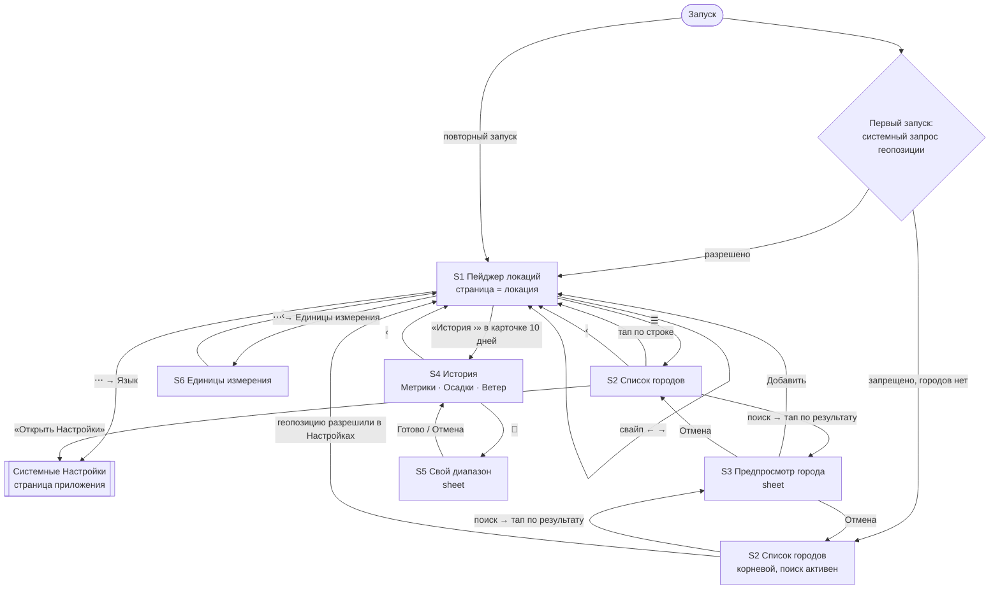

# MyWeather: UX-решения

**Статус:** закрыто. Все вопросы §9 продуктового документа имеют ответ.
**Дата:** 07.10.2026 (первая редакция — 01.10.2026; правки по итогам UX-критики — 07.10.2026)
**Входной документ:** `docs/product-decisions.md` (дальше — «продукт»)
**Потребитель:** агент-архитектор (по порядку работы из продукта §0)

### Как читать пометки

| Пометка | Значит | Можно ли менять |
|---|---|---|
| **[Edward]** | решено в обсуждении с заказчиком | только с заказчиком |
| **[продукт §X]** | пришло из продуктового документа | нет, это вводные |
| **[сам: основание]** | закрыто дизайнером по конвенции или следствию | архитектор может вернуть с возражением, если не ложится на `ChartKit` |

Отвергнутые варианты по спорным пунктам даны одной строкой «почему не».

**Термины.** «Полосы» и «режим полос» — то же, что «агрегированный режим» в глоссарии продукта (`ChartBand`, суточные мин/сред/макс). «Линии» — линейный режим. «График метрик» — график с чипсами: почасовой на главном и вид «Метрики» в истории.

### Изменение продукта, принятое по итогам обсуждения

**Эксклюзивных метрик в чипсах нет.** Осадки и направление ветра не выбираются на графике метрик: у них свои блоки (карточки «Осадки» и «Ветер» на главном, виды «Осадки» и «Ветер» в истории). **[Edward]**
Внесено в продукт §4.1, §9.2.7, §9.4.21, §10 и в research №17 (07.10.2026). Остальные правила §4.1 соблюдены: лимит две серии, последнюю метрику снять нельзя, чипсы под графиком, haptic на выбор.

**По итогам UX-критики (07.10.2026)** **[Edward]**, в продукт не вносилось:
- **Триггеры обновления** расширены сверх продукта §6.5: страница с истёкшим TTL тихо обновляется, когда становится видимой (§4.6).
- **Палитра** — два цвета по рядам, а не девять по метрикам, как предполагал продукт §9.4.21 (§7.2).
- **Дневной график** — 10 дней, а не весь горизонт Forecast API (S1).


**Второй круг UX-критики (11.10.2026)** **[Edward]**:
- **Ветер — одна роза, круговой диаграммы нет** (S1). Внесено в продукт §3.1, §9.3.16, §10 и в research №15.
- **Осадки в истории** — нативная прокрутка с укрупнением столбцов (S4) вместо «весь диапазон целиком»; с продуктом §3.1 теперь совпадает.
- **«Текущая погода»** всегда из почасового прогноза на текущий час, снимок `current` не используется (§6.2).

### Уточнения к продукту, принятые по ходу

- **Граница 7 дней:** диапазон **≤ 7 дней включительно** — линии, **> 7 дней** — полосы. Пресет «7 д» в истории единственный рисуется линиями. **[сам: research §3.1 считает 7 дней = 168 часовых точек; заказчик не возразил]**
- **Длина диапазона** = число календарных суток локации, включая обе границы. «25 сен – 1 окт» — 7 суток, линии; «24 сен – 1 окт» — 8 суток, полосы. Правило одно для пресетов и для своего диапазона (S5). **[сам: без определения граница 7 дней читается двояко]**
- **Сегодняшний день в истории кончается на текущем часе** (время локации): прогнозных часов в истории нет. **[сам: история — про прошлое; прогноз показан на главном]**
- **Честный объём данных** **[Edward]** (так сделано в winery на Android): ось X покрывает выбранный период целиком, до конца сегодняшних суток, а линия кончается на текущем часе — правее пусто, линия не растягивается до края. Полоса сегодняшнего дня строится по фактическим часам, показание над ней — «Сегодня, до 14:00» (§4.3). Если в видимом периоде одна точка (свой диапазон «сегодня» в начале суток), она рисуется точкой, а не пропадает.
- **Пункт меню «Метрики» (продукт §7.3)** — это единицы измерения. В интерфейсе называется «Единицы измерения». **[Edward]** (продукт §3.1 «Настройки — единицы, язык»)

---

## 1. Пользователь и сценарии

**Персона:** человек, которому погода любопытна чуть больше среднего. **[Edward]**

| Сценарий | Частота | Длительность | Вопрос | Где отвечаем |
|---|---|---|---|---|
| **Быстрый взгляд** — главный | каждый день | 10–15 с | что сейчас, что в ближайшие часы, брать ли зонт | первый экран главного: текущая погода + почасовой график; вероятность осадков по часам — один тап «Сравнить» |
| **Ближайшие дни** | несколько раз в неделю | ~30 с | какой будет неделя, где дождь, откуда ветер | ниже на главном: 10 дней, осадки, ветер |
| **Копнуть историю** | эпизодически | 1–3 мин | теплее ли этот сентябрь прошлых; каким был июль 5 лет назад | экран «История», на одно касание глубже главного |

Следствие для иерархии: всё, что нужно для быстрого взгляда, помещается без прокрутки. История доступна, но её не видно, пока её не ищут. **[Edward]**

**Референсы.** Из Apple Weather берём **структуру и поведение**: длинный скролл карточек, свайп между городами, список с поиском, нативные компоненты, показание выбранной точки над графиком. Визуальный язык **сдержаннее Apple**: фон не спорит с графиками. Антиреференсы — плотность дашбордов (Windy, Ventusky) и рекламно-перегруженные погодники. **[Edward]**

**Тон** — нейтрально-человеческий: короткие законченные фразы, без шуток и без приборного жаргона. «Не удалось обновить», а не «Ошибка −1009» и не «Тучи сгустились над сервером». **[Edward]**

---

## 2. Навигация

### 2.1 Карта экранов



### 2.2 Решения по навигации

| Решение | Источник |
|---|---|
| Корень — горизонтальный пейджер локаций. Каждая страница — вертикальный скролл карточек одной локации | [сам: ответ Б → структура Apple Weather] |
| Первая страница — текущая геопозиция (если разрешена), дальше города в ручном порядке списка | [сам: Apple Weather; продукт §5] |
| Внизу системные точки страниц, закреплены поверх скролла у нижнего края экрана. Точка геопозиции — значок `location.fill` | [сам: Apple Weather; иначе индикатор не виден на первом экране] |
| Тулбар сверху: слева `☰` (список городов), справа `⋯` (меню настроек) | [Edward] |
| Нижнего тулбара нет | [Edward] — «почему не как у Apple»: настройки уже справа сверху (продукт §7.3), вторая панель без карты лишняя |
| `☰` открывает S2 переходом в навигационном стеке. Тап по городу возвращает в пейджер на страницу этого города | [сам: HIG, навигационный стек] |
| Если геопозиция запрещена и городов нет, S2 становится корнем, кнопки «назад» нет | [сам: продукт §5] |
| `⋯` — системный выпадающий `Menu` с двумя пунктами: «Единицы измерения», «Язык» | [продукт §7.3] + [сам: HIG, `Menu`] |
| «Язык» открывает страницу приложения в системных Настройках (штатный выбор языка приложения в iOS) | [сам: HIG; внутренний переключатель идёт против платформы] |
| Если у устройства один предпочитаемый язык, iOS не показывает выбор языка на странице приложения. В этом случае «Язык» вместо перехода открывает sheet с пояснением: язык приложения выбирается в Настройках, сначала добавьте второй язык в «Основные → Язык и регион». Кнопки: «Открыть Настройки», «Закрыть» | [Edward] — иначе переход ведёт на страницу без выбора языка |
| «История» — ссылка `История ›` в заголовке карточки «10 дней»; S4 открывается переходом в стеке, кнопка «назад» подписана названием города | [Edward] — «почему не карточка внизу»: дальше от места, где возникает вопрос; «почему не расширение почасового графика»: смешало бы два режима |
| История привязана к локации страницы, с которой в неё вошли. Чтобы сменить локацию, нужно вернуться на главный экран и перелистнуть страницу | [сам: следствие входа из карточки] |
| **При запуске** пейджер открывается на первой странице: геопозиция, а без неё — первый город списка | [сам: сценарий «быстрый взгляд» — сначала там, где вы] |
| **Удалён город, со страницы которого пришли в S2:** «‹» возвращает на соседнюю предыдущую страницу, если её нет — на первую | [сам] |
| **Города переставили в S2:** «‹» возвращает на тот же город, с которого пришли, на его новом месте, а не на прежний номер страницы | [Edward] |
| **Разрешение на геопозицию выдали** (в системных Настройках): страница геопозиции встаёт первой, пейджер остаётся на городе, который был открыт | [Edward] |
| **Разрешение отозвали**, пока открыта страница геопозиции: она исчезает, пейджер переходит на первый город; если городов нет — S2 корнем | [Edward] |
| **Разрешение отозвали, пока открыта история страницы геопозиции:** S4 остаётся открытой (координаты и данные у неё есть); по «‹» — пейджер уже без страницы геопозиции, по правилу строки выше | [Edward] |

### 2.3 Жесты и их приоритет

| Где | Жест | Результат |
|---|---|---|
| Страница вне графиков | горизонтальный свайп | соседняя локация |
| Страница | вертикальный скролл | прокрутка карточек |
| Страница S1, экран S4 | pull-to-refresh | обновление [продукт §6.5] |
| График метрик (почасовой, история) | горизонтальный drag | pan графика, а **не** смена страницы |
| График метрик | pinch | zoom [продукт §4.2] |
| График метрик | pan до края данных | график упирается; жест пейджеру **не** передаётся |
| Любой линейный/полосный график | long-press → drag | crosshair [продукт §4.2] |
| Любой график с crosshair | отпускание пальца | crosshair и показание исчезают |
| Дневной график | горизонтальный drag | ничего, график показан целиком; свайп уходит пейджеру [продукт §4.2] |
| Карточка осадков (S1) | горизонтальный drag | нативная прокрутка столбцов, а не смена страницы |
| Столбцы осадков (S1, история) | тап по столбцу | выбор столбца |
| Роза ветров | тап по лепестку | выбор направления |
| Ряд чипсов | горизонтальный drag | скролл ряда, а не смена страницы |
| Ряд чипсов | тап по чипу | выбор метрики для этого ряда (§4.2) |

Правило одной строкой: **горизонтальный жест внутри области графика или ряда чипсов принадлежит им, вне их — пейджеру**. [сам: Apple Weather — почасовая лента внутри страницы ведёт себя так же]

---

## 3. Экраны

Вайрфреймы нарисованы для ширины около 390 pt. Отличия на краях 320 и 440 pt оговорены у каждого экрана.

### S1. Страница локации (главный экран)

**Назначение:** сценарии «быстрый взгляд» и «ближайшие дни».
**Порядок блоков** **[Edward]**:
1. текущая погода;
2. баннер устаревших данных (только когда нужен);
3. почасовой прогноз;
4. 10 дней;
5. осадки;
6. ветер.

Блоки — карточки в одном скролле. **[Edward]** — «почему не переключатель между графиками»: тяжёлых графиков на главном нет (до 336 точек, 17 столбцов, 8 лепестков), а сценарий «ближайшие дни» держится на простой прокрутке, без знания, куда нажать.

**Без прокрутки:** текущая погода и почасовой график целиком (390–440 pt). На SE (568 pt высоты) — текущая погода и верхняя часть графика. Это допустимо. **[Edward]**

```
┌──────────────────────────────────┐
│ ☰                            ⋯   │
│        ➤ Моё местоположение      │ ← только на странице геопозиции
│            Москва                │
│             14°                  │ ← самый крупный текст экрана
│          ☁️ Облачно               │
│   Ощущается как 12° · ↑18° ↓9°   │
│ ┌──────────────────────────────┐ │
│ │ Не удалось обновить ·        │ │ ← только при неудачном обновлении
│ │ данные от 14:20 · ↻          │ │
│ └──────────────────────────────┘ │
│ ┌ ПОЧАСОВОЙ ПРОГНОЗ ─ [⧉ Сравнить]│
│ │ ●°C                          │ │ ← единица над осью + точка серии
│ │ 18┤ ░░    ╱‾‾╲     ░░░░      │ │
│ │   │ ░░ __╱    ╲__  ░░░░      │ │ ← ░ ночь, ☀︎↑ / ☀︎↓ у верхнего края
│ │ 10┤ ░░╱          ╲_░░░░      │ │
│ │    12   15   18   21   00    │ │
│ │ (🌡 Температура)(🧍)(☂)(💧)(≋→│ │ ← ряд чипсов (§4.1)
│ └──────────────────────────────┘ │
│ ┌ 10 ДНЕЙ ──────── История › ──┐ │
│ │ °C ☀ ⛅ ☁ 🌧 🌧 ⛅ ☀ ☀ ⛅ ☁ │ │ ← единица над осью; иконка погоды по дню
│ │ 20┤┄▒▓▒┄┄┄▓▓▒┄┄┄┄┄┄┄┄┄┄┄┄┄┄┄ │ │ ← ось Y, пунктирная линия сетки
│ │ 10┤┄┄┄┄▒▓▓▒┄┄▒▓▒┄┄┄┄▒▓┄┄┄┄┄ │ │   от каждого деления
│ │    ср 1   пт 3   вс 5   вт 7 │ │
│ └──────────────────────────────┘ │
│ ┌ ОСАДКИ ──────────────────────┐ │
│ │ Сегодня: 2,4 мм              │ │
│ │  ▃   █   ▁       ▅  ▂     →  │ │
│ │ Сег  чт  пт  сб  вс  пн  вт  │ │
│ └──────────────────────────────┘ │
│ ┌ ВЕТЕР · 7 ДНЕЙ ──────────────┐ │
│ │ Сейчас: 5 м/с СЗ · порывы 9  │ │
│ │ Чаще с СЗ · сильнее с З      │ │ ← сводка розы
│ │            ✳ роза            │ │ ← в центре «Штиль 4 %»
│ └──────────────────────────────┘ │
│   …                              │
│ Обновлено в 14:20 ·              │ ← нижняя строка, в конце скролла
│ Данные: Open-Meteo               │
│              ➤ • ○               │ ← точки страниц, закреплены
└──────────────────────────────────┘
```

#### Блок «Текущая погода»

- Состав: подпись «Моё местоположение» с `location.fill` (только на странице геопозиции), название города, температура, иконка и описание по `weather_code`, строка «Ощущается как 12° · ↑18° ↓9°». **[продукт §3.1]**; макс/мин сегодняшнего дня из `daily` — **[сам: Apple Weather, данные уже есть]**.
- Пока название города геопозиции не определено (или его не удалось определить), заголовком служит «➤ Моё местоположение», а отдельная подпись над ним не показывается — чтобы фраза не стояла дважды. **[Edward]**
- Нажимать здесь нечего.

#### Карточка «Почасовой прогноз»

- **Период:** с 00:00 сегодня (время локации) на 7 суток вперёд, 168 ч. **[Edward]**
- **Видимое окно при открытии:** 24 ч, начиная с текущего часа. Линия уходит за край, и это само подсказывает, что график можно тянуть. Отдельной подсказки нет. **[Edward]** (закрывает продукт §9.3.13)
- **Сброс окна к «24 ч с текущего часа»:** при запуске приложения, при **каждом** возврате из фона (независимо от TTL) и при pull-to-refresh. Сброс привязан к этим событиям, а не к приходу данных: тихое обновление при перелистывании на страницу (§4.6) окно не трогает, иначе оно прыгало бы под пальцем через секунду после свайпа. Свайп между страницами окно не трогает: у каждой страницы своё. Кнопки «вернуться к сейчас» нет: сброс происходит сам ровно тогда, когда возвращаешься за быстрым взглядом. **[Edward]**
- **По умолчанию:** одна метрика — Температура, «Сравнить» выключено. **[Edward]** — «почему не пара с вероятностью осадков»: в схеме с двумя рядами пара стоит второго ряда и 44 pt в зоне быстрого взгляда; сравнение — действие, которое человек делает сам. Вероятность осадков включается одним тапом «Сравнить» (естественная пара, §4.2).
- **Чипсы и «Сравнить»** — §4.1–4.2. Набор — девять метрик §5.1.
- **Взаимодействия:** drag — pan в пределах 7 суток; pinch — zoom (минимальное окно 6 ч, максимальное — 7 суток); long-press → drag — crosshair. **[продукт §4.2]** + пределы **[сам]**.
- **Ночь и солнце:** затенение ночных интервалов, значки `sunrise.fill` / `sunset.fill` у верхнего края без вертикальных линий. **[сам]**
- **Ширина 320 pt:** видно около двух с половиной чипсов, деления оси X каждые 6 ч. На 390–440 pt — около трёх чипсов, деления каждые 3 ч (подбор «красивых» делений, research №10).

#### Карточка «10 дней»

- **Период:** 10 дней прогноза, начиная с сегодня. Показан целиком, без pan/zoom. **[Edward]** — «почему не все 16 дней, которые отдаёт Forecast API»: 16 — предел источника, а не польза; прогноз на 11–16 день почти не точнее климатической нормы, а график рисует его так же уверенно, как завтрашний. Ориентир — Apple Weather. Pan/zoom нет — **[продукт §4.2]**.
- **Иконки погоды по дням:** ряд иконок (§7.5, по суточному `weather_code`) над подписями оси X, по одной на день, около 14 pt. На 320 pt около 24 pt на день. **[Edward]** — без них на вопрос «какая будет неделя» нет ответа: температура и суммы осадков не говорят, солнечно или пасмурно.
- **Содержимое:** только температура, полосы мин/сред/макс, и ряд иконок. **Чипсов и «Сравнить» нет.** **[Edward]** — почему не чипсы: разбор метрик за этот период — это история, одно касание из этой же карточки.
- **Взаимодействия:** long-press → drag — crosshair, показание над графиком (§4.3). Pan/zoom нет. **[продукт §4.2]**
- **Ось Y со шкалой температуры**, как на почасовом графике: единица «°C» над осью, деления по подбору «красивого» шага (research №10), от каждого деления — горизонтальная пунктирная линия сетки через весь график (штатная `AxisGridLine` Swift Charts). По линии сетки значение полосы читается без касания; точное число — crosshair. **[Edward]** — «почему не числа макс/мин у каждого дня, как в Apple Weather»: сетка уже даёт чтение без касания и сохраняет один язык с остальными графиками, а подписи по 24 pt на день на 320 pt впритык.
- **В заголовке справа** ссылка `История ›`. **[Edward]**
- Подписи оси X: день недели + число («ср 1»), шаг подбирается по ширине.

#### Карточка «Осадки»

- **Данные:** суточные суммы за период от −7 до +10 дней. **[Edward]** — горизонт прогноза согласован с карточкой «10 дней».
- **Видимое окно:** 7 дней, сегодня у левого края. Прокрутка нативная в обе стороны. **[Edward]**, **[продукт §3.1]**
- **Строка-сводка** над графиком: «Сегодня: 2,4 мм». Если выбран день — «Чт, 3 окт: 12,5 мм». **[сам]**
- **Тап по столбцу** выбирает день: остальные столбцы гаснут до 30 %, над выбранным выноска со значением. Повторный тап по тому же столбцу или тап мимо снимает выбор. Crosshair здесь нет. **[сам: исходник `RainfallChart`, продукт §0 п.3]**
- **Аномалия:** столбец ≥ 15 мм/сут красный (§7.4).
- Столбец «сегодня» подписан «Сегодня» вместо дня недели.
- Часовых осадков на главном нет: на вопрос «во сколько дождь» отвечает вероятность осадков на почасовом графике. **[Edward]**

#### Карточка «Ветер · 7 дней»

- **Период распределения:** те же 7 суток прогноза, что у почасового графика. **[Edward]**
- **Строка «Сейчас»:** «Сейчас: 5 м/с СЗ · порывы 9 м/с». Если порывы ≥ 15 м/с, их значение красное (§7.4). **[Edward]** + аномалия **[сам]**.
- **Один график — роза ветров.** Круговой диаграммы нет. **[Edward]** — «почему не пончик»: в пончике угол сектора задаёт доля, поэтому стороны света раскладываются по кругу как придётся — «С» не наверху, «СЗ» не слева сверху. Направление — величина пространственная, у розы стороны стоят на своих местах. Второй график ради средней скорости не нужен: она есть в сводке и при выборе лепестка.
- **Направление** — откуда дует ветер (метеорологическая конвенция): лепесток «СЗ» значит «ветер с северо-запада». **[сам: так же в строке «Сейчас»]**
- **Роза:** 8 лепестков, **длина пропорциональна доле времени** по направлению — *откуда дует чаще*. Цвет — §7.2. Направление без единого часа лепестка не имеет. По центру карточки, на 320 pt около 180 pt. **[Edward]**
- **Сводка над розой:** «Чаще с СЗ · сильнее с З». «Чаще» — направление с наибольшей долей, «сильнее» — с наибольшей средней скоростью среди направлений с долей ≥ 2 % (средняя по нескольким часам случайна). Если это одно направление — «Чаще и сильнее с СЗ». **[Edward]** + порог 2 % **[сам]**
- **Центр розы в покое:** доля штиля, две строки «Штиль» / «4 %». Если штиля меньше 1 %, центр пуст. **[Edward]**
- **Тап по лепестку** выбирает направление: лепесток подсвечен, остальные гаснут, в центре три строки «СЗ» / «23 %» / «средняя 4 м/с». Повторный тап по нему же или тап мимо лепестков снимает выбор. Способ хит-теста — за архитектором. **[Edward]**
- **Порог штиля:** < 0,5 м/с. Это **новое поведение**: в исходнике штиль — `spd <= 0`, а модельный ряд Open-Meteo почти не даёт ровного нуля, так что сектор штиля был бы всегда пуст. **[сам: шкала Бофорта, 0 баллов]**

### S2. Список городов

**Назначение:** переключение локаций, пополнение и упорядочивание списка.

```
┌──────────────────────────────────┐
│ ‹                  Изменить      │
│ Города                           │ ← большой заголовок
│ ┌──────────────────────────────┐ │
│ │ 🔍 Поиск города              │ │ ← .searchable
│ └──────────────────────────────┘ │
│ ┌──────────────────────────────┐ │
│ │ ➤ Моё местоположение     14° │ │ ← всегда первым, не двигается,
│ │   Москва · 14:32    ☁️ ↑18 ↓9 │ │   не удаляется
│ ├──────────────────────────────┤ │
│ │ Токио                    22° │ │
│ │ 20:32               ☀️ ↑25 ↓19│ │ ← местное время города
│ ├──────────────────────────────┤ │
│ │ Лиссабон                 19° │ │
│ │ 12:32               🌧 ↑21 ↓15│ │
│ └──────────────────────────────┘ │
└──────────────────────────────────┘
```

- **Строка города:** название, местное время локации, иконка, текущая температура, макс/мин. **[сам: Apple Weather; продукт §2.5 — время локации]**
- **Тап по строке** — возврат в пейджер на страницу этого города.
- **Удаление** — свайп влево. **Перестановка** — режим «Изменить» и перетаскивание. Строка геопозиции не удаляется и не перемещается. **[продукт §5]** + **[сам: HIG List, Apple Weather]**
- **Поиск:** при вводе выдача заменяет список. Строка результата — «Город», ниже «Регион, Страна». Тап открывает S3. **[продукт §5, Edward — ответ Е]** + **[сам: Apple Weather]**
- **Город уже в списке:** в выдаче у него галочка `checkmark`. Тап по нему возвращает в пейджер на этот город, S3 не открывается. **[сам]**
- **Геопозиция запрещена:** над полем поиска строка-пояснение и кнопка «Открыть Настройки». Когда разрешение выдано в системных Настройках, строка исчезает, а геопозиция появляется первой в списке и первой страницей пейджера. **[продукт §5]** + **[сам: HIG — объяснить отказ и дать путь назад]**
- **Разрешение выдали, пока S2 — корень** (городов нет): S2 сразу сменяется пейджером на странице геопозиции, так же как после добавления первого города. Пользователь ходил в Настройки именно за этим. **[Edward]**
- **Корневой режим** (геопозиции нет, городов нет): кнопки «назад» нет, поиск активен сразу, под полем подсказка «Найдите город, чтобы увидеть погоду». **[сам: следствие продукта §5]**
- **Если удалён последний город и геопозиции нет**, S2 переходит в корневой режим. **[сам]**

### S3. Предпросмотр города (sheet)

```
┌──────────────────────────────────┐
│ Отмена                 Добавить  │
│            Токио                 │
│             22°                  │
│          ☀️ Ясно                  │
│   Ощущается как 23° · ↑25° ↓19°  │
│ ┌ ПОЧАСОВОЙ ПРОГНОЗ ─ [⧉ Сравнить]│
│ │ …как на S1…                  │ │
│ └──────────────────────────────┘ │
│ …остальные карточки как на S1…   │
└──────────────────────────────────┘
```

- Содержимое — страница S1 этого города, со всеми карточками и взаимодействиями. **Ссылки «История ›» нет**: история — для сохранённых локаций. **[сам: Apple Weather; история в предпросмотре расширила бы кэш на город, который могут не добавить]**
- «Добавить» — город встаёт в конец списка, sheet закрывается, пейджер открывается на нём. «Отмена» — назад к выдаче. **[сам: Apple Weather]**

### S4. История

**Назначение:** сценарий «копнуть историю». **[Edward]**

```
┌──────────────────────────────────┐
│ ‹ Москва         История         │
│ ┌──────────────────────────────┐ │
│ │▐Метрики▌│ Осадки │  Ветер    │ │ ← что смотрим
│ └──────────────────────────────┘ │
│ ┌──────────────────────────┐ ┌──┐│
│ │ 7 д │▐30 д▌│ Год │ 5 лет │ │📅││ ← за какой период, общий для трёх видов
│ └──────────────────────────┘ └──┘│
│  2 сен – 1 окт · по суткам:      │ ← строка диапазона
│  мин – сред – макс               │
│ ┌ Среднее: ●14° ── [⧉ Сравнить] ┐│
│ │ ●°C                          │ │
│ │ 20┤   ▒▓▓▒    ▒▓▒            │ │
│ │ 10┤ ▒▓▒   ▒▓▓▒   ▒▓▓▒        │ │
│ │    5 сен   12 сен   19 сен   │ │
│ │ (●Темп.)(Ощущается)(Влажн… → │ │
│ └──────────────────────────────┘ │
└──────────────────────────────────┘
```

**Общее для трёх видов**

- **Состав:** переключатель вида → контрол диапазона → строка диапазона → содержимое вида. **[Edward]**
- **Переключатель вида** — сегментированный контрол `Метрики | Осадки | Ветер`. **[Edward]** — «почему не `.menu`»: три коротких варианта видны сразу и переключаются одним тапом, в меню выбор скрыт и стоит два тапа; «почему не карточки в скролле, как на главном»: пятилетние выборки по осадкам и ветру считаются только для открытого вида, а в истории исследуют одно за раз; «почему не меню в заголовке» (`toolbarTitleMenu`): выбор вида снова прячется.
- **Диапазон общий** для трёх видов: при смене вида сохраняется. **[Edward]**
- **При каждом заходе:** вид «Метрики», диапазон «30 д». Вид и диапазон между заходами не запоминаются. **[Edward]** + незапоминание **[сам]**
- **Фон** системный, без погодного градиента. **[Edward]** — градиент говорит «сейчас», а не про показываемый период.
- **Ширина 320 pt:** у контрола диапазона около 59 pt на сегмент, «5 лет» помещается; кнопка календаря 44 pt. У переключателя вида около 96 pt на сегмент.

**Вид «Метрики»**

- График метрик + ряды чипсов + «Сравнить» (§4.1–4.2). Кнопка «Сравнить» — в верхней строке карточки графика справа, слева от неё — среднее за период; заголовка у карточки нет, его роль играет переключатель вида.
- **По умолчанию:** Температура, «Сравнить» выключено. **[Edward]**
- **Среднее за период** **[Edward]**: в верхней строке карточки слева, напротив «Сравнить» — «Среднее: ●14°» или при сравнении «Среднее: ●14° · 62 %●» (точки и стороны — как в показании, §4.3). Считается по видимому окну: без приближения это весь выбранный диапазон. Появляется после полной загрузки, как «Всего за период» у осадков. Пока палец на графике, строку заменяет показание. Почему: на вопрос «теплее ли этот сентябрь прошлых» нужна одна цифра, которую можно сравнить, переключая свой диапазон; наложение периодов — отдельная фича после MVP (§10).
- **Набор чипсов истории:** девять метрик §5.1 минус **метрики без архивных данных**: вероятность осадков точно, УФ-индекс — по итогам сверки Open-Meteo. Такие чипы **не показываются**, а не выглядят неактивными. **[сам: реанализ ERA5 не содержит величин прогноза]**
- **Выбор у истории свой** и запоминается отдельно от почасового. **[Edward]**
- **Видимое окно** — весь выбранный диапазон. Сбрасывается к нему при каждой смене диапазона **и при смене вида**: ушёл в «Осадки» и вернулся — зума нет, как в ядре winery. **[сам]** + смена вида **[Edward]**
- **Взаимодействия:** pan/zoom в пределах выбранного диапазона; минимальное окно — 6 ч на линиях, 7 суток на полосах; максимальное — весь диапазон. Long-press → drag — crosshair. **[продукт §4.2]** + пределы **[сам]**.
- **Вид графика определяется диапазоном, а не зумом.** Приблизил год до 7 суток — остаются полосы. **[сам: продукт §2.3 говорит о диапазоне]**
- **Пока график приближен**, строка диапазона показывает видимые даты, а справа от неё стоит кнопка «↺ Весь период». Кнопка возвращает окно ко всему диапазону и исчезает. Без приближения строка показывает выбранный диапазон, как в §«Строка диапазона». Отдельной подсказки о зуме нет. **[Edward]** — иначе строка подписывает не то, что видно, а путь назад есть только щипком.

**Вид «Осадки»**

```
│ ┌──────────────────────────────┐ │
│ │ Всего за период: 312 мм      │ │ ← сводка; при выборе — значение столбца
│ │ ▂ ▅ █ ▃ ▁ ▂ ▆ ▃ ▂ ▁ ▄ ▇      │ │
│ │ янв     апр     июл     окт  │ │
│ └──────────────────────────────┘ │
```

- **Нативная прокрутка столбцов** (`chartScrollableAxes`), без pan/zoom, как у карточки на S1 и у `RainfallChart` в winery. Столбец укрупняется по длине диапазона так, чтобы на экране был один осмысленный «период», а остальное — прокруткой. Ориентир — «Здоровье»: годовой вид там показан месяцами. На длинном диапазоне смотрят общую динамику, а не конкретный день. **[Edward]** — «почему не весь диапазон целиком» (первая редакция): 30–60 столбцов на 320 pt — это 4–8 pt на столбец, штрихкод, в который не попасть тапом.

| Длина диапазона | Столбец | Видно на экране | Прокрутка |
|---|---|---|---|
| 7 д | сутки | 7 | нет |
| 30 д, свой ≤ 31 суток | сутки | 14 (две недели) | да |
| свой 32–183 суток | неделя | 13 (≈ 3 месяца) | да |
| «Год», свой > 183 суток | месяц | 12 | у «Года» нет; у своего длиннее года — да |
| 5 лет | месяц | 12 (год) | да, всего 60–61 столбец |

- **Начальная позиция прокрутки** — у правого края, на самых свежих столбцах: открыл «5 лет» — видишь последние 12 месяцев, прошлое — прокруткой влево. Как на S1, где сегодня у края, а прошлое за ним. **[Edward]**
- На 320 pt место под столбец при 12–14 видимых — 17–20 pt; `chartXSelection` выбирает ближайший столбец по X, так что попадание тапом надёжное.

- Неделя начинается с первого дня недели по локали. Крайние неполные недели и месяцы — суммы за их покрытую часть. **[сам]**
- **Сводка над графиком:** «Всего за период: 312 мм» — за **весь выбранный диапазон**, а не за видимое окно: строка диапазона подписывает весь период, и цифра не должна меняться при прокрутке. **[Edward]** Тап по столбцу — сводка показывает его: «Чт, 3 окт: 12,5 мм» / «2–8 сен: 21 мм» / «Сентябрь 2024: 54 мм». Выбор и гашение остальных столбцов — как на S1. **[сам]**
- **Аномалия** (≥ 15 мм/сут) — только на суточных столбцах. К сумме за неделю или месяц критерий «сильный дождь» неприменим. **[Edward]**
- Строка диапазона: «2 сен – 1 окт · суммы по дням» / «по неделям» / «по месяцам».

**Вид «Ветер»**

- Роза со сводкой, как на S1, но **за выбранный диапазон**. Заголовка «Сейчас» нет: история — про прошлое. **[Edward]**
- Строка диапазона: «2 сен – 1 окт · распределение направлений».

#### Контрол диапазона **[Edward]**

- Сегментированный контрол `7 д | 30 д | Год | 5 лет` + отдельная кнопка `calendar` справа.
- Пресеты заканчиваются сегодняшним днём (время локации, текущий час).
- Кнопка календаря открывает S5. Пока выбран свой диапазон, **ни один сегмент не подсвечен, а кнопка календаря тонирована акцентом** — так видно, что действует свой диапазон. Сегмент не подсвечивается, даже если свой диапазон совпал с пресетом. **[Edward]** Тап по любому пресету возвращает к пресету, крестика нет.
- Почему не меню с «Произвольный…»: пресеты переключают часто, в меню это два тапа вместо одного. Почему не пятый сегмент «⋯»: сегмент, открывающий окно, ломает ожидание мгновенного переключения.

#### Строка диапазона **[Edward]**

Всегда под контролом: реальные даты + что показано в текущем виде.
- «Метрики», ≤ 7 дней: «25 сен – 1 окт · по часам».
- «Метрики», > 7 дней: «2 сен – 1 окт · по суткам: мин – сред – макс».
- «Осадки»: «… · суммы по дням / по неделям / по месяцам».
- «Ветер»: «… · распределение направлений».
- Если диапазон затрагивает прошлые годы, у дат указан год: «3 мар 2021 – 1 окт 2026».

### S5. Свой диапазон (sheet)

```
┌──────────────────────────────────┐
│ Отмена    Свой диапазон   Готово │
│ ┌──────────────────────────────┐ │
│ │ С                 2 сент 2026│ │ ← компактный DatePicker
│ ├──────────────────────────────┤ │
│ │ По                1 окт 2026 │ │
│ └──────────────────────────────┘ │
└──────────────────────────────────┘
```

- Sheet средней высоты (`.medium` detent). **[сам: HIG]**
- Даты ограничены промежутком [сегодня − 5 лет; сегодня]. Поле «По» не даёт выбрать дату раньше «С», а при сдвиге «С» позже «По» значение «По» подтягивается к «С». Недопустимый диапазон собрать нельзя, поэтому ошибок валидации нет. **[Edward]** + механика **[сам]**
- При открытии подставлен текущий диапазон экрана.
- «Готово» применяет, «Отмена» закрывает без изменений.

### S6. Единицы измерения

```
┌──────────────────────────────────┐
│ ‹            Единицы измерения   │
│ ┌──────────────────────────────┐ │
│ │ Температура          °C    ⌄ │ │
│ │ Скорость ветра       м/с   ⌄ │ │
│ │ Осадки               мм    ⌄ │ │
│ │ Давление             гПа   ⌄ │ │
│ └──────────────────────────────┘ │
└──────────────────────────────────┘
```

- `Form`, четыре строки с inline-`Picker` (меню). Варианты — **[продукт §7.1]**.
- Начальное значение — из региональных настроек системы. **[продукт §7.1]** iOS даёт только систему мер и единицу температуры, поэтому остальное выводится по таблице **[Edward]**:

| Величина | Правило |
|---|---|
| Температура | системная настройка температуры |
| Осадки | система мер `us` → дюймы, остальные → мм |
| Скорость ветра | `us` / `uk` → mph; регион RU, BY, KZ → м/с; остальные → км/ч |
| Давление | регион RU, BY, KZ → мм рт. ст.; остальные → гПа |
- Смена применяется сразу, на всех экранах, без перезагрузки данных и без индикатора. **[сам: продукт §7.1 — хранение в СИ]**
- Открывается переходом в стеке из меню `⋯`. **[сам]**

---

## 4. Компоненты и поведение

### 4.1 Ряды чипсов и «Сравнить» **[Edward]**

```
«Сравнить» выкл.                          «Сравнить» вкл.
┌ ПОЧАСОВОЙ ПРОГНОЗ ──── [⧉ Сравнить] ┐   ┌ ПОЧАСОВОЙ ПРОГНОЗ ──── [⧉ Сравнить] ┐ ← тонирована
│ ●°C                                 │   │ ●°C                            ●%   │
│ …график…                            │   │ …график…                            │
│ (🌡 Температура)(🧍)(☂)(💧)(≋)(⏱)(☁ → │   │ (🌡 Температура)(🧍)(💧)(≋)(⏱)(☁)  → │ ← ряд 1: левая ось
└─────────────────────────────────────┘   │ (🌡)(🧍)(☂ Вер. осадков)(💧)(≋)  → │ ← ряд 2: правая ось
                                          └─────────────────────────────────────┘
```

- **Ряд = одна серия.** Первый ряд выбирает метрику левой оси, второй — правой. В каждом ряду всегда выбрано ровно одно: это одиночный выбор, как у сегментированного контрола. Лимит «две серии» (продукт §4.1) выражен структурой: рядов два. Правило «нельзя снять последнюю» (продукт §4.1) выполняется само: в ряду снять выбор нельзя.
- **Кнопка «Сравнить»** — справа в верхней строке карточки графика, кнопка-переключатель (`⧉` + «Сравнить»). Включённая тонирована акцентом. Включение — второй ряд выезжает анимацией под первым; выключение — второй ряд уходит вместе со своей метрикой.
- **Компоновка ряда:** одна строка, горизонтальный скролл, высота около 44 pt. Ряды прокручиваются независимо. **[Edward]** — «почему не перенос строк»: 150–190 pt высоты выталкивают дневной прогноз за край экрана.
- **Порядок чипсов фиксированный** (§5.1), выбранный вперёд не переезжает. **[Edward]**
- **Вид чипа — как категории в Apple Mail** **[Edward]**:
  - невыбранный — **свёрнутый**: только иконка метрики (§5.1) серого цвета на нейтральном фоне, без текста;
  - выбранный — **раскрытый**: иконка + короткое имя (§5.1), фон цвета своего ряда (§7.2) с прозрачностью около 20 %, обводка цвета ряда, текст основного цвета;
  - смена выбора — анимация: новый чип раскрывается, прежний сворачивается, соседи сдвигаются.

  Цвет фона — **[сам: белый текст на светлом оранжевом или голубом нечитаем, а текст цветом серии нарушает контраст]**. Выбранный чип всегда несёт имя, поэтому легенда остаётся текстовой. Цена: невыбранную метрику узнают только по иконке, поэтому иконки девяти метрик обязаны быть различимы (§5.1).
- **Прокрутка к выбранному:** ряд прокручивается так, чтобы выбранный чип был виден, — при появлении карточки, при включении «Сравнить» (ряд 2 с предвыбранной метрикой) и после выбора. **[Edward]**
- **Заблокированных чипов нет.** **[Edward]**
- **Чипсы и есть легенда.** Отдельной легенды нет. Если выбранный чип уехал за край скролла, связь «цвет → метрика» держат подписи осей с цветными точками и показание над графиком. Цвет у ряда, а не у метрики (§7.2), поэтому выбранный чип тонирован цветом своего ряда. **[Edward]** **[сам]**, **[Edward]**
- **Haptic** `selection` — на каждый выбор чипа и на переключение «Сравнить». **[продукт §4.1]**

**Почему так** — путь, который прошло обсуждение, одной строкой на вариант:
- автозамена «выбранной раньше» при лимите — неожиданно пропадает метрика;
- блокировка с подсказками и тряской — правильно, но смена метрики стоит два тапа и знания механики;
- режим «Сравнить», меняющий смысл тапа по тому же ряду, — скрытое состояние;
- **два ряда одиночного выбора** — тап всегда значит одно: «показать эту метрику здесь», смена метрики — один тап.

### 4.2 Правила выбора **[Edward]**

| Ситуация | Результат |
|---|---|
| Тап по невыбранному чипу в ряду | метрика ряда заменяется, график перерисовывается |
| Тап по выбранному чипу в ряду | ничего: в ряду всегда выбрано одно |
| «Сравнить»: включение | появляется ряд 2 с предвыбранной метрикой (ниже) |
| «Сравнить»: выключение | ряд 2 и его серия уходят, ряд 1 не меняется |
| «Сравнить» включено | **в каждом ряду нет метрики, выбранной в другом**: по восемь чипсов в ряду (в истории — сколько доступно минус одна). Выбрать в одном ряду метрику другого ряда невозможно |
| Метрику сменили в одном ряду | в другом ряду возвращается прежняя и исчезает новая; соседние чипы сдвигаются на ширину чипа. Сдвиг происходит в соседнем ряду, а не под пальцем |
| «Сравнить» выключено | в ряду 1 все чипы |

- **Почему метрика другого ряда скрыта, а не заблокирована и не меняется местами** — **[Edward]**: заблокированный чип вернул бы блокировки, от которых ушли; обмен рядами по тапу — скрытое правило; асимметрия «скрыта только в ряду 2» оставляла случай, требующий особого поведения. Симметричное правило формулируется одной фразой. Ряды прокручиваются независимо, выравнивать их не нужно.
- **Предвыбор второго ряда при включении «Сравнить»:** **[сам: естественные пары — продукт §4.1]**
  1. если на этом экране уже сравнивали — последняя метрика второго ряда (если она не совпадает с метрикой ряда 1);
  2. иначе естественная пара для метрики ряда 1:

| Ряд 1 | Ряд 2 по умолчанию |
|---|---|
| Температура | Вер. осадков (в истории, где её нет, — Влажность) |
| Ощущается | Температура |
| Ветер | Порывы |
| Порывы | Ветер |
| остальные | Температура |

  3. если кандидат недоступен или совпадает с рядом 1 — первая по порядку §5.1 из оставшихся.
- **Состояние запоминается** — метрика ряда 1, включено ли «Сравнить», метрика ряда 2 — отдельно у почасового графика и у истории, общее для всех локаций. **[Edward]** + общее для локаций **[сам: метрика — интерес пользователя, а не свойство города]**
- Предпросмотр S3 показывает и меняет состояние почасового графика. **[сам]**

### 4.3 Crosshair и показание над графиком **[Edward]**

```
Покой                                  Палец на графике (полосы, сравнение)
┌ ПОЧАСОВОЙ ПРОГНОЗ ─ [⧉ Сравнить] ┐   ┌──────────────────────────────────┐
│ ●°C                         ●%   │   │ Чт, 3 окт 2024                   │ ← вместо верхней строки
│ 18┤    ╱‾‾╲          ┤80         │   │ ●12° 9–18°          70 % 55–92 %●│ ← вместо строки единиц
│   │ __╱    ╲__       │           │   │ 18┤   ▒▓▓│▒    ▒▓▒   ┤80         │
│ 10┤             ╲__  ┤20         │   │ 10┤ ▒▓▒  ┃ ▒▓▓▒      ┤20         │
```

- **Вызов:** long-press, затем drag. **[продукт §4.2]** Отпускание пальца — показание исчезает, верхние строки возвращаются.
- **Показание стоит над графиком**, на месте верхней строки карточки (заголовок и «Сравнить») и строки единиц. График не сдвигается и ничем не перекрыт. Смена строк — растворение около 0,15 с. **[Edward]** — паттерн Apple Weather, «Здоровья» и «Акций». «Почему не карточка сбоку от пальца»: на 320 pt область графика около 230 pt, и карточка накрывала бы crosshair и точки.
- **Состав:**
  - строка 1 — дата/время в поясе локации **[продукт §2.5]**: «Чт, 3 окт, 14:00» на линиях, «Чт, 3 окт 2024» на полосах (год, если не текущий);
  - строка 2 — значения: **серия ряда 1 прижата влево, серия ряда 2 — вправо**, у каждой цветная точка со стороны своей оси; названий нет — сторона и цвет связывают значение с серией;
  - правило без исключений: даже если обе метрики в одной единице и делят левую ось, значение ряда 2 стоит справа. Иначе «●14° ●12°» различались бы только цветом точки, а контраст серий допустим лишь потому, что значение никогда не передаётся одним цветом (§7.2). **[Edward]**
  - линии: «●14°», «40 %●»; полосы: «●12° 9–18°» — среднее крупнее и насыщеннее, диапазон «мин–макс» мельче вторичным цветом **[продукт §9.3.11]**;
  - единица — рядом со значением (в покое она подписана над осью);
  - сегодняшний день на полосах в истории неполный (история кончается текущим часом): строка 1 — «Сегодня, до 14:00», чтобы мин/сред/макс не читались как итог дня. **[Edward]**
- **Не помещается в строку** (худший случай — давление в мм рт. ст. на полосах на 320 pt): серия ряда 2 переходит на строку ниже, эта строка заходит на верх графика. Это единственное исключение из правила «график ничем не перекрыт». **[Edward]** Размер измеряется по содержимому, а не задаётся числом. **[продукт §4.2]** + правило **[сам]**
- **У карточки «10 дней»** одна серия: строка 1 — дата, иконка и описание погоды («Чт, 3 окт · ☁ Пасмурно»), строка 2 — «●12° 9–18°» слева. **[Edward]** В истории вида «Метрики» верхней строкой служит строка с «Сравнить».
- **Вид crosshair:** вертикальная линия вторичного цвета 1 pt; на каждой серии белая точка с обводкой цвета серии, около 8 pt; на полосах три точки (мин, сред, макс). **[сам: исходник, research №12]**
- **Там, где данных нет, crosshair исчезает целиком** — и линия, и точки, и показание; верхние строки карточки возвращаются. Это касается незагруженной части (прогрессивная загрузка, §6.3), части, которая не загрузилась, и пустого хвоста после текущего часа («Честный объём данных»). Вернулся палец на данные — crosshair появляется снова, жест не прерывается. **[Edward]**
- **Haptic на границе данных:** лёгкий отклик (`selection`), когда crosshair исчезает при уходе пальца с данных и когда появляется при возврате на них. Палец чувствует край данных, не глядя на график. Срабатывает только на этой границе; при обычном вызове crosshair долгим нажатием и при отпускании пальца отклика нет. **[Edward]** (приём из winery, research №9)
- На столбцах осадков и розе ветров crosshair нет, у них выбор тапом. **[продукт §0 п.3]**

### 4.4 Две оси

- Ряд 1 — левая ось, ряд 2 — правая. **[Edward]** — следствие двух рядов.
- Над осью подписана единица («°C», «%») и цветная точка её серии. Подписи делений нейтрального вторичного цвета. **[сам]**
- Если «Сравнить» выключено или обе метрики в одной единице (температура + ощущается, ветер + порывы), правой оси нет: обе серии на левой, над ней две точки. **[сам]**

### 4.5 Смена вида графика (история, вид «Метрики»)

- Вид меняется только сменой диапазона (≤ 7 дней → линии, > 7 → полосы).
- **Переход — кросс-фейд около 0,25 с.** **[Edward]** — «почему не морфинг»: линия, перетекающая в полосу, выглядит как ошибка отрисовки; «почему не мгновенно»: подмена читается как сбой сильнее растворения.
- Объяснение постоянное, через строку диапазона (§3, S4). Подсказок «при первом показе» нет. **[Edward]**

### 4.6 Прочие правила

- **Аномалии** (§7.4) — на графике перекраска марок, без иконок и подписей. Объяснение — словом там, куда пользователь смотрит при выборе: в сводке выбранного столбца осадков «Чт, 3 окт: 22 мм · сильный дождь», в показании порывов «17 м/с · сильный ветер», в строке «Сейчас» «порывы 17 м/с · сильный ветер». Иначе красная точка на линии читается как ошибка данных или выбранная точка. **[Edward]**
- **Ночь** затеняется только в линейном режиме: у суточных полос ночи нет. **[сам: следствие продукта §2.3]**
- **Обновление при возврате в приложение** (истёк TTL, продукт §6.5) проходит тихо, без индикатора: контент просто сменяется. Индикатор только у pull-to-refresh. **[сам: HIG — фоновое обновление не прерывает]**
- **Что обновляется, кроме pull-to-refresh** **[Edward]** — расширение триггеров продукта §6.5:
  - возврат в приложение — только видимая страница;
  - страница пейджера стала видимой, и у неё истёк TTL — тихое обновление по тому же правилу;
  - открытие S2 — строки с истёкшим TTL;
  - вход в S4 — свежий хвост из прогноза, если истёк TTL.

  Почему: иначе перелистнул на город, открытый три часа назад, и видишь старый прогноз без всякой пометки — баннер появляется только после *неудачного* обновления. С этим правилом: открыл приложение или перелистнул на страницу, обновление прошло, баннера нет — данным меньше часа. Это не гарантия на всё время: если приложение открыто дольше часа без этих событий, данные стареют без пометки, таймера нет (продукт §6.5). **[Edward]**
- **Нижняя строка** — в конце скролла S1 и S3, мелким вторичным текстом: «Обновлено в 14:20 · Данные: Open-Meteo». На S4 — только «Данные: Open-Meteo». На первом экране её нет: при правиле выше она нужна только тем, кому интересно. Указание источника заодно выполняет требование лицензии Open-Meteo (CC BY 4.0). **[Edward]**
- **Время в баннере и в нижней строке** — в **поясе устройства**, а не локации: это момент жизни пользователя («когда я последний раз обновлял»), а не время погоды. Если не сегодня — «данные от 29 сент., 14:20». **[сам]**
- **Баннер** — строка на системном материале под блоком текущей погоды (в истории — под строкой диапазона). Текст говорит, что случилось, и время данных: «Не удалось обновить · данные от 14:20 · ↻»; на узких экранах и с датой переносится на вторую строку. **[Edward]** Тап — обновить, закрыть нельзя. Появляется, только когда обновление не удалось и на экране кэш. Исчезает после успешного обновления. **[сам: продукт §6.6 — «ненавязчиво» значит в потоке контента, без перекрытия]**

---

## 5. Метрики

### 5.1 Чипсы: порядок **[Edward]**

| # | Метрика | Чип (ru / en) | Иконка (SF Symbols, iOS 17) | Единица | В истории |
|---|---|---|---|---|---|
| 1 | Температура | Температура / Temperature | `thermometer.medium` | °C·°F | да |
| 2 | Ощущается как | Ощущается / Feels Like | `thermometer.variable.and.figure` | °C·°F | да |
| 3 | Вероятность осадков | Вер. осадков / Precip. Chance | `umbrella.percent` | % | **нет** (нет в архиве) |
| 4 | Влажность | Влажность / Humidity | `humidity` | % | да |
| 5 | Скорость ветра | Ветер / Wind | `wind` | м/с·км/ч·mph·уз | да |
| 6 | Порывы ветра | Порывы / Gusts | `gauge.open.with.lines.needle.84percent.exclamation` — слабое место, см. ниже | та же, что у ветра | да |
| 7 | Облачность | Облачность / Cloud Cover | `cloud` | % | да |
| 8 | Давление | Давление / Pressure | `barometer` | гПа·мм рт. ст. | да |
| 9 | УФ-индекс | УФ / UV | `sun.max` | без единицы (своя ось) | по итогам сверки архива |

- **Иконки** проверены по каталогу SF Symbols: все доступны с iOS 17 или раньше. Пары, которые смотрят вместе, различаются силуэтом: термометр и термометр с фигурой, `wind` и стрелка спидометра. Для порывов своего символа в SF Symbols нет; спидометр с восклицательным знаком читается как «пиковая скорость». Если на устройстве он не будет считываться — запасной путь — собственный символ (`wind` с бейджем), экспортированный из шаблона SF Symbols. **[Edward]** (стиль чипов) + подбор **[сам]**
- Влажность поднята на четвёртое место: она в осмысленной паре с температурой (продукт §4.1). **[Edward]**
- Осмысленные пары по продукту §4.1: температура + ощущается, температура + вероятность осадков, температура + влажность, ветер + порывы. Они же — естественные пары для «Сравнить» (§4.2).
- **Не в чипсах** (продукт §4.1): **осадки** — карточка «Осадки» на S1 и вид «Осадки» в истории; **направление ветра** — карточка «Ветер» на S1 и вид «Ветер» в истории. **[Edward]**
- **«Порывы»** — максимальные кратковременные (несколько секунд) всплески скорости внутри часа; при ветре 5 м/с порывы бывают до 12 м/с. На чипе «Порывы» читается рядом с «Ветер». **[сам: вопрос возник у заказчика — возникнет и у пользователя]**

### 5.2 По умолчанию **[Edward]**

| Экран | Ряд 1 | «Сравнить» |
|---|---|---|
| Почасовой прогноз (S1, S3) | Температура | выключено |
| История, вид «Метрики» | Температура | выключено |

---

## 6. Состояния

Принцип **[продукт §6.6]**: пустого экрана нет там, где есть хоть какие-то данные. Страница локации загружается и ошибается **целиком**, карточки по отдельности не падают **[сам: все карточки S1 питаются одним прогнозом]**. Пустого графика метрик не бывает: в ряду 1 всегда выбрана метрика.

### 6.1 Матрица

| Экран | Первая загрузка (кэша нет) | Пусто | Ошибка, кэша нет | Ошибка обновления, кэш есть | Офлайн | Первый запуск | Геопозиция запрещена |
|---|---|---|---|---|---|---|---|
| **S1 страница локации** | скелетон всех карточек (`.redacted(.placeholder)`), название города видно, если известно | не бывает: страница существует только у локации, у неё есть данные или ошибка | `ContentUnavailableView` вместо карточек: «Не удалось загрузить погоду» + «Повторить»; работает и pull-to-refresh; название города видно | кэш + баннер «Не удалось обновить · данные от 14:20 · ↻»; «сейчас» и карточки — по правилу старого кэша (§6.2) | = одна из двух колонок слева, смотря есть ли кэш | под системным запросом разрешения — пустой системный фон; после ответа — пейджер или S2 | страницы геопозиции нет; если есть города — пейджер без неё; если нет — S2 корнем |
| **S1, страница геопозиции, координаты не получены** | скелетон, заголовок «Моё местоположение» | не бывает | «Не удалось определить местоположение» + «Проверьте, включены ли службы геолокации…» + «Повторить» (если нет последних координат с кэшем) | кэш последних координат + баннер | как слева | — | страницы нет |
| **S2 список городов** | строки городов со скелетоном погоды справа | корневой режим: поиск активен + «Найдите город, чтобы увидеть погоду» | у строки нет погоды — справа прочерк «—»; список работает | строки с кэшированной погодой, без баннера (не главный экран) | как слева | — | строка-пояснение + «Открыть Настройки» над поиском |
| **S2 выдача поиска** | `ProgressView` по центру под полем | «Ничего не найдено» + «Проверьте написание или попробуйте другое название.» (`ContentUnavailableView.search`) | «Поиск недоступен» + «Проверьте подключение к интернету.» | не бывает: выдача не кэшируется | = ошибка | — | — |
| **S3 предпросмотр** | скелетон карточек | не бывает | `ContentUnavailableView` + «Повторить»; «Добавить» доступна (город можно сохранить и без погоды) | не бывает: у нового города нет кэша | = ошибка | — | — |
| **S4 «Метрики»** | **прогрессивно:** ось сразу на весь диапазон, загруженное рисуется, остальное — бледная скелетон-полоса «Загрузка…»; куски приходят от новых к старым | не бывает: диапазон в пределах 5 лет, ряд ERA5 без дыр | на месте графика `ContentUnavailableView` «Не удалось загрузить историю» + «Повторить»; переключатель вида и контрол диапазона активны | архив не устаревает; если не обновился свежий хвост из прогноза — баннер под строкой диапазона | кэшированные диапазоны работают полностью (архив бессрочный, продукт §6.1); нескачанное — как «ошибка, кэша нет» для своей части | — | — |
| **S4 «Метрики», догрузка части упала** | — | — | — | загруженное нарисовано; на месте незагруженной части полоса «Не загружено · ↻», тап повторяет | как слева | — | — |
| **S4 «Осадки»** | прогрессивно: загруженные столбцы рисуются, незагруженные — скелетон-столбцы; сводка «Всего за период» появляется после полной загрузки | не бывает | как «Метрики» | как «Метрики» | как «Метрики» | — | — |
| **S4 «Осадки», догрузка части упала** (или офлайн, диапазон закэширован частично) | — | — | — | загруженные столбцы нарисованы; на месте незагруженных полоса «Не загружено · ↻», тап повторяет; сводка вместо «Всего за период» — «Загружено частично» **[Edward]** | как слева | — | — |
| **S4 «Ветер»** | `ProgressView` до полной загрузки: распределение по части периода было бы неправдой | не бывает | как «Метрики»: «Не удалось загрузить историю» + текст + «Повторить» | как «Метрики» | как «Метрики» | — | — |
| **S4 «Ветер», догрузка части упала** (или офлайн, диапазон закэширован частично) | — | — | — | целиком как «ошибка, кэша нет»: «Не удалось загрузить историю» + «Повторить». Частичное распределение не показываем по той же причине, что и при загрузке **[Edward]** | как слева | — | — |
| **S5 свой диапазон** | не бывает: только локальный выбор | не бывает | не бывает | не бывает | работает | — | — |
| **S6 единицы** | не бывает | не бывает | не бывает | не бывает | работает | значения из региона | — |

### 6.2 Старый кэш **[Edward]**

Кэш может быть сколько угодно старым: три дня офлайна, три недели. Правило:

- **Блок «Текущая погода»** берётся из закэшированного почасового прогноза **на текущий час**, а не из снимка «сейчас» на момент загрузки. Это правило **всегда, а не только для старого кэша**: снимок `current` Open-Meteo не используется вовсе. Один источник — число совпадает с точкой «сейчас» на почасовом графике и не скачет при переходе онлайн ↔ офлайн. Цена — точность до часа вместо 15 минут; `current` поверх почасового — возможное улучшение после первой версии. **[Edward]**
- **Строки S2** живут по тому же правилу: температура и иконка — из почасового на текущий час; если кэш текущий час не покрывает — прочерк «—». **[Edward]** Макс/мин — из закэшированного `daily` на сегодня.
- **Карточки** показывают только ту часть своего периода, которую кэш покрывает. Почасовой: от 00:00 сегодня до конца закэшированного прогноза. «10 дней»: оставшиеся дни. Осадки: покрытые дни. Ветер: распределение по покрытой части 7 суток.
- Возраст данных сообщает баннер («Не удалось обновить · данные от 28 сент., 14:20 · ↻») и нижняя строка страницы, отдельной пометки на блоках нет.
- **Если кэш не покрывает текущий час** (закэширован полный ответ Forecast API на 16 дней, значит, после двух с лишним недель без обновления), страница переходит в состояние «ошибка, кэша нет».
- Почему не показывать снимок как есть: он выдаёт старую погоду за текущую, и баннер этого не исправляет.

### 6.3 Загрузка пятилетнего ряда **[Edward]**

Прогрессивная отрисовка (строки S4 в матрице).
- Почему: почти всегда часть диапазона уже в кэше (продукт §6.4), и её надо показать сразу. Прямое следствие продукта §6.6.
- Pan работает по всей оси диапазона. Над незагруженной частью crosshair исчезает (§4.3). **[Edward]**
- Роза ветров ждёт полной загрузки.
- Почему не затемнённый старый график со спиннером: пауза ощущается целиком.

### 6.4 Первый запуск

1. Системный запрос «При использовании». Онбординга нет. **[продукт §5]**
2. Разрешено → пейджер со страницей геопозиции (скелетон → данные).
3. Запрещено → S2 корнем, со строкой-пояснением. **[продукт §5]**

---

## 7. Визуальный язык

### 7.1 Фон **[Edward]**

- Спокойный градиент за скроллом S1 и S3, **без анимации**.
- 6 групп `weather_code` × день/ночь (`is_day`) × тема:

| Группа | Коды WMO | День | Ночь |
|---|---|---|---|
| Ясно | 0, 1 | голубой | тёмно-синий |
| Облачно | 2, 3 | серо-голубой | графитовый |
| Туман | 45, 48 | светло-серый | серый |
| Дождь | 51–67, 80–82 | сизый | тёмно-сизый |
| Снег | 71–77, 85, 86 | бело-голубой | холодный серо-синий |
| Гроза | 95–99 | тёмно-сизый с фиолетовым | почти чёрный с фиолетовым |

- В светлой теме тона пастельные, в тёмной — глубокие. Тема системная, погода меняет только оттенок. **[продукт §7.4]**
- Карточки на `.regularMaterial`: графики всегда читаются на материале, а не на градиенте.
- S2, S4, S5, S6 — системный фон.
- **S1 и S3 без данных** (скелетон, ошибка без кэша) — системный фон: `weather_code` ещё нет. Градиент проявляется кросс-фейдом, когда данные пришли. **[сам]**
- Почему без анимации: Б просил «спокойнее Apple», анимация отвлекает от графиков и съедает производительность.

### 7.2 Палитра **[Edward]**

**Цвет означает ряд (ось), а не метрику.** На графике максимум две серии, у каждой уже есть подпись: чип и единица над осью. Цвету остаётся одна работа — различить левую и правую серию и связать линию с осью и рядом чипсов. Поэтому цветов серий два.

| Роль | Цвет | Светлая / тёмная |
|---|---|---|
| **Ряд 1** — левая ось, выбранный чип ряда 1, точка над осью, точка в показании | `orange` | `#FF9500` / `#FF9F0A` |
| **Ряд 2** — правая ось и всё перечисленное для ряда 2 | `cyan` | `#32ADE6` / `#64D2FF` |
| Графики с одной серией: «10 дней», роза ветров | цвет ряда 1 | — |
| Столбцы осадков (карточка, вид истории) | `blue` | `#007AFF` / `#0A84FF` |
| **Аномалия** | `red`, **зарезервирован** | `#FF3B30` / `#FF453A` |

- Метрика своего цвета не имеет: температура в ряду 2 голубая. Пара по умолчанию «температура + вероятность осадков» выглядит как привычные «тепло оранжевое, вода голубая».
- Почему не цвет на метрику (первая редакция): девять цветов дублировали подпись, две пары не проходили порог различимости, а «температура + ощущается», идущие почти слипшись, различались только подбором оттенков. При цвете по ряду любая пара различима одинаково хорошо.
- **Проверка валидатором** (`dataviz/scripts/validate_palette.js`; поверхность `#F2F2F7` / `#2C2C2E`):

| Пара | ΔE светлая / тёмная | Итог |
|---|---|---|
| Ряд 1 / Ряд 2 | 31,3 / 28,8; при дальтонизме 24,2 / 25,5 | ✓ с запасом, проходит и для дальтоников |
| Ряд 1 / аномалия | 17,1 / 18,4; при дальтонизме 11,1 / 12,1 | ✓, но близко — точки аномалий получают белую обводку 1,5 pt |
| Ряд 2 / столбцы осадков | 15,1 / — | не встречаются на одном графике |

- Контраст оранжевого и голубого к светлой поверхности ниже 3:1 (1,97 и 2,28). Это допустимо, потому что значения никогда не передаются только цветом: подписи осей, показание и чипы несут текст. Текст цветом серии не красится (§4.1). В тёмной теме системные тона светлее рекомендуемой полосы яркости — принимаем ради системных цветов.
- **Почему не пунктир** для различения пар: пунктиром в режиме полос уже нарисованы границы мин/макс. **[Edward]**
- **Полосы:** заливка цветом серии с прозрачностью около 20 %, линия среднего сплошная 2 pt, границы мин/макс пунктиром 1 pt. Где две полосы перекрываются, читаемость держат линии среднего и границы, а не заливка. **[сам: исходник `SensorChart`]**

### 7.3 Ночь и солнце **[сам]**

- Ночные интервалы — заливка основным цветом текста с прозрачностью около 6 %, на всю высоту графика, за сериями.
- Восход и закат — значки `sunrise.fill` / `sunset.fill` вторичного цвета у верхнего края, без вертикальных линий.

### 7.4 Аномалии **[сам]**

| Где | Порог | Как |
|---|---|---|
| Суточные столбцы осадков (S1; история «Осадки» при диапазоне ≤ 31 суток) | ≥ 15 мм/сут | столбец `red` |
| Недельные и месячные столбцы (история «Осадки») | — | не подсвечиваются [Edward] |
| Порывы на линейном графике | ≥ 15 м/с | точки-маркеры `red` с белой обводкой на часах выше порога, сама линия цвета своего ряда |
| Порывы в режиме полос | максимум дня ≥ 15 м/с | маркер `red` на границе максимума |
| Строка «Сейчас» в карточке ветра | порывы ≥ 15 м/с | значение порывов `red` |
| Сводка выбранного суточного столбца, показание порывов, строка «Сейчас» | те же пороги | приписка словом: «· сильный дождь» / «· сильный ветер» (§4.6) [Edward] |

Основания: 15 мм/сут — нижняя граница критерия Росгидромета «сильный дождь» (15–49 мм за ≤ 12 ч), применённая к суточной сумме: порог мягче критерия, но суточная сумма — единственная гранулярность карточки; 15 м/с — Росгидромет, «сильный ветер». Пороги задаются в СИ и при смене единиц не меняются.

### 7.5 Иконки погоды **[сам: продукт §7.5, HIG, Apple Weather]**

SF Symbols в multicolor, дневной/ночной вариант по `is_day`:

| Коды WMO | День | Ночь |
|---|---|---|
| 0 | `sun.max.fill` | `moon.stars.fill` |
| 1, 2 | `cloud.sun.fill` | `cloud.moon.fill` |
| 3 | `cloud.fill` | `cloud.fill` |
| 45, 48 | `cloud.fog.fill` | `cloud.fog.fill` |
| 51, 53, 55 | `cloud.drizzle.fill` | `cloud.drizzle.fill` |
| 56, 57, 66, 67 | `cloud.sleet.fill` | `cloud.sleet.fill` |
| 61, 63 | `cloud.rain.fill` | `cloud.rain.fill` |
| 65 | `cloud.heavyrain.fill` | `cloud.heavyrain.fill` |
| 71, 73, 75, 77 | `cloud.snow.fill` | `cloud.snow.fill` |
| 80, 81, 82 | `cloud.sun.rain.fill` | `cloud.moon.rain.fill` |
| 85, 86 | `cloud.snow.fill` | `cloud.snow.fill` |
| 95 | `cloud.bolt.rain.fill` | `cloud.bolt.rain.fill` |
| 96, 99 | `cloud.hail.fill` | `cloud.hail.fill` |

### 7.6 Тёмная тема

Обязательна, следует системной. **[продукт §7.4–7.5]** Все цвета выше — системные или заданные парами «светлая/тёмная». Белые точки crosshair в тёмной теме остаются белыми (контраст к фону карточки обеспечивает цветная обводка). **[сам]**

---

## 8. Тексты

### 8.1 Тон **[Edward]**

Нейтрально-человеческий. Короткие законченные фразы. Ошибка говорит, что случилось и что сделать. Без шуток, без кодов ошибок, без восклицаний.

### 8.2 Форматы значений **[сам: Apple Weather + разумная точность модели]**

| Величина | Точность | В показании и карточках | На оси |
|---|---|---|---|
| Температура, ощущается (°C/°F) | целое | «14°» | деления «14», единица «°C» над осью |
| Влажность, облачность, вероятность | целое | «45 %» (пробел по правилам локали) | «45», «%» над осью |
| Осадки, мм | 1 знак; ноль — «0 мм»; суммы за неделю и месяц — целое | «2,4 мм», «54 мм» | «2», «мм» над осью |
| Осадки, дюймы | 2 знака; ноль — «0 дюйм.» / «0 in»; суммы за неделю и месяц — 1 знак | «0,09 дюйм.» / «0.09 in» | «0,1», «дюйм.» / «in» над осью |
| Ветер, порывы (все единицы) | целое | «5 м/с» | «5», «м/с» над осью |
| Направление (карточка ветра) | сторона света | «СЗ» | — |
| Давление (гПа / мм рт. ст.) | целое | «1013 гПа» | «1013», «гПа» над осью |
| УФ-индекс | целое | «6» | «6», подпись «УФ» над осью |

- В значениях единица сокращённая («дюйм.», «in»), в пикере S6 — название варианта полностью («дюймы», «in»). **[Edward]**
- Числа, разделители, единицы и порядок слов форматируются **системными форматтерами по локали устройства**. Таблица показывает ожидаемый вид, источник истины — система. Захардкоженных локалей нет. **[продукт §7.2]**
- Время — 24- или 12-часовой формат по настройкам системы. **[сам]**
- Время на графиках, в показании, в списке городов — в поясе локации; в баннере — в поясе устройства (§4.6).
- Подписи оси X:
  - линии: часы («12», «15»), полночь — день («ср 3»);
  - 30 д — «3 окт»;
  - год — месяцы («янв»);
  - 5 лет — годы («2023»).

  **[сам]**
- Стороны света: С, СВ, В, ЮВ, Ю, ЮЗ, З, СЗ / N, NE, E, SE, S, SW, W, NW.

### 8.3 Строки

| Ключ (смысл) | ru | en |
|---|---|---|
| Подпись геопозиции | Моё местоположение | My Location |
| Ощущается | Ощущается как %@ | Feels like %@ |
| Заголовок почасового | Почасовой прогноз | Hourly Forecast |
| Кнопка сравнения | Сравнить | Compare |
| Заголовок дневного | 10 дней | 10-Day Forecast |
| Ссылка в историю | История | History |
| Заголовок осадков | Осадки | Precipitation |
| Сводка осадков, сегодня | Сегодня: %@ | Today: %@ |
| Сводка осадков, период | Всего за период: %@ | Total for period: %@ |
| Сводка осадков, выбранный столбец | %1$@: %2$@ («Чт, 3 окт: 12,5 мм») | %1$@: %2$@ |
| Показание, неполный сегодняшний день | Сегодня, до %@ | Today, until %@ |
| Среднее за период (метрики истории) | Среднее: %@ | Average: %@ |
| Заголовок ветра на S1 | Ветер · 7 дней | Wind · 7 Days |
| Ветер сейчас | Сейчас: %1$@ %2$@ · порывы %3$@ | Now: %1$@ %2$@ · gusts %3$@ |
| Штиль | Штиль | Calm |
| Сводка розы | Чаще с %1$@ · сильнее с %2$@ | Mostly from %1$@ · strongest from %2$@ |
| Сводка розы, одно направление | Чаще и сильнее с %@ | Mostly and strongest from %@ |
| Сегодня (ось) | Сегодня | Today |
| Средняя скорость направления | средняя %@ | average %@ |
| Баннер | Не удалось обновить · данные от %@ | Couldn't update · data from %@ |
| Нижняя строка S1/S3 | Обновлено в %@ · Данные: Open-Meteo | Updated %@ · Data: Open-Meteo |
| Нижняя строка S4 | Данные: Open-Meteo | Data: Open-Meteo |
| Ошибка без кэша, заголовок | Не удалось загрузить погоду | Couldn't Load Weather |
| Ошибка без кэша, текст | Проверьте подключение к интернету и попробуйте снова. | Check your internet connection and try again. |
| Кнопка повтора | Повторить | Try Again |
| Нет координат | Не удалось определить местоположение | Couldn't Determine Location |
| Нет координат, текст | Проверьте, включены ли службы геолокации, и попробуйте снова. | Make sure Location Services are on and try again. |
| Системный запрос геопозиции (`NSLocationWhenInUseUsageDescription`) | Чтобы показывать погоду там, где вы находитесь. | To show the weather where you are. |
| Ошибка истории, заголовок | Не удалось загрузить историю | Couldn't Load History |
| Ошибка истории, текст | Проверьте подключение к интернету или выберите другой период. | Check your internet connection or choose another period. |
| Загрузка части графика | Загрузка… | Loading… |
| Часть не загрузилась | Не загружено | Not Loaded |
| Сводка осадков, часть не загрузилась | Загружено частично | Partially loaded |
| Аномалия осадков (приписка) | %@ · сильный дождь | %@ · heavy rain |
| Аномалия порывов (приписка) | %@ · сильный ветер | %@ · strong wind |
| Виды истории | Метрики · Осадки · Ветер | Metrics · Precipitation · Wind |
| Пресеты | 7 д · 30 д · Год · 5 лет | 7D · 30D · 1Y · 5Y |
| Строка диапазона, часы | %1$@ – %2$@ · по часам | %1$@ – %2$@ · hourly |
| Строка диапазона, сутки | %1$@ – %2$@ · по суткам: мин – сред – макс | %1$@ – %2$@ · daily: min – avg – max |
| Строка диапазона, осадки по дням | %1$@ – %2$@ · суммы по дням | %1$@ – %2$@ · daily totals |
| Строка диапазона, осадки по неделям | %1$@ – %2$@ · суммы по неделям | %1$@ – %2$@ · weekly totals |
| Строка диапазона, осадки по месяцам | %1$@ – %2$@ · суммы по месяцам | %1$@ – %2$@ · monthly totals |
| Строка диапазона, ветер | %1$@ – %2$@ · распределение направлений | %1$@ – %2$@ · direction distribution |
| Сброс зума в истории | Весь период | Full Range |
| Sheet «Язык», заголовок | Язык приложения | App Language |
| Sheet «Язык», текст | Язык приложения выбирается в Настройках. Чтобы выбор появился, добавьте второй язык в «Основные → Язык и регион». | The app language is set in Settings. To see the option, add a second language in General → Language & Region. |
| Sheet «Язык», кнопки | Открыть Настройки · Закрыть | Open Settings · Close |
| Заголовок S5 | Свой диапазон | Custom Range |
| Поля S5 | С · По | From · To |
| Кнопки | Готово · Отмена · Добавить · Изменить | Done · Cancel · Add · Edit |
| Заголовок S2 | Города | Cities |
| Поле поиска | Поиск города | Search for a city |
| Пустой список | Найдите город, чтобы увидеть погоду | Search for a city to see the weather |
| Нет результатов | Ничего не найдено | No Results |
| Нет результатов, текст | Проверьте написание или попробуйте другое название. | Check the spelling or try another name. |
| Поиск недоступен | Поиск недоступен | Search Unavailable |
| Поиск недоступен, текст | Проверьте подключение к интернету. | Check your internet connection. |
| Геопозиция запрещена | Нет доступа к геопозиции. Разрешите его в Настройках, чтобы видеть погоду там, где вы. | Location access is off. Allow it in Settings to see the weather where you are. |
| Кнопка в Настройки | Открыть Настройки | Open Settings |
| Меню `⋯` | Единицы измерения · Язык | Units · Language |
| Заголовок S6 | Единицы измерения | Units |
| Строки S6 | Температура · Скорость ветра · Осадки · Давление | Temperature · Wind Speed · Precipitation · Pressure |
| Варианты единиц | °C, °F · м/с, км/ч, миль/ч, уз · мм, дюймы · гПа, мм рт. ст. | °C, °F · m/s, km/h, mph, kn · mm, in · hPa, mmHg |

Названия метрик для чипов и их иконки — в таблице §5.1.

### 8.4 Описания погоды (`weather_code`)

| Коды | ru | en |
|---|---|---|
| 0 | Ясно | Clear |
| 1 | Преимущественно ясно | Mostly Clear |
| 2 | Переменная облачность | Partly Cloudy |
| 3 | Пасмурно | Cloudy |
| 45 | Туман | Fog |
| 48 | Туман с изморозью | Freezing Fog |
| 51 / 53 / 55 | Слабая морось / Морось / Сильная морось | Light Drizzle / Drizzle / Heavy Drizzle |
| 56 / 57 | Ледяная морось | Freezing Drizzle |
| 61 / 63 / 65 | Небольшой дождь / Дождь / Сильный дождь | Light Rain / Rain / Heavy Rain |
| 66 / 67 | Ледяной дождь | Freezing Rain |
| 71 / 73 / 75 | Небольшой снег / Снег / Сильный снег | Light Snow / Snow / Heavy Snow |
| 77 | Снежная крупа | Snow Grains |
| 80 / 81 / 82 | Небольшой ливень / Ливень / Сильный ливень | Light Showers / Showers / Heavy Showers |
| 85 / 86 | Снегопад / Сильный снегопад | Snow Showers / Heavy Snow Showers |
| 95 | Гроза | Thunderstorm |
| 96 / 99 | Гроза с градом | Thunderstorm with Hail |

---

## 9. Архитектору

Отложенные технические вопросы и UX-требования, ограничивающие реализацию. Нумерация «Q» ссылается на `chartkit-research-context.md` §7.

1. **Правило выбора метрик** (research №17, продукт §4.1): эксклюзивных метрик в чипсах нет; механика — «два ряда одиночного выбора, в каждом ряду нет метрики, выбранной в другом» (§4.1–4.2).
2. **Прогрессивная загрузка истории (Q8).** График принимает данные частями: ось на весь диапазон сразу, загруженные куски от новых к старым, незагруженная часть — отдельно стилизованная полоса; над ней, как и над любым местом без данных, crosshair скрыт целиком, а жест продолжается; на переходе через границу данных в обе стороны — haptic `selection` (§4.3). Сам детект разрывов (№9) не переносится, нужен только признак «под пальцем нет данных» и событие его смены. То же для столбцов вида «Осадки». Если это не ложится на `ChartKit` — вернуть с возражением (§6.3).
3. **Приоритет жестов.** Горизонтальный drag внутри графика (pan), нативный скролл карточки осадков и скролл рядов чипсов не должны перелистывать пейджер. Вне них свайп листает страницы. Третий уровень вложенности поверх механизма отмены украденного жеста (research №4): пейджер → вертикальный скролл → график.
4. **Показание над графиком** (§4.3) заменяет плавающий тултип исходника: механизм удержания тултипа в границах (research №11) в нынешнем виде не нужен; нужна зона над областью графика, измеряемая по содержимому, с правилом переноса второй серии на строку ниже. Продукт §4.2 «тултип в границах графика» соблюдён: показание внутри карточки.
5. **Чипсы истории зависят от архива.** Вероятность осадков в архиве отсутствует; наличие УФ-индекса сверить с Open-Meteo. Чип метрики без архивных данных в истории не показывается; естественная пара заменяется по §4.2.
6. **Вид «Осадки» в истории** — суммы по дням / неделям / месяцам по длине диапазона (§3, S4), нативная прокрутка (`chartScrollableAxes` + `chartXVisibleDomain`), стартовая позиция — правый край. Проверить, что выбор столбца в исходном `RainfallChart` залипает после отпускания, как описано в S1, а не держится только под пальцем. Агрегация недель (по первому дню недели локали) и месяцев — в поясе локации.
7. **Вид «Ветер» в истории.** Источник направлений на диапазонах до 5 лет (суточное доминирующее направление или почасовые ряды) — техническое решение. UX требует по 8 секторам долю времени и среднюю скорость, плюс долю штиля, за выбранный диапазон.
8. **Ленивость видов истории:** данные вида «Осадки» и «Ветер» загружаются и считаются при открытии вида, а не вместе с «Метриками».
9. **Название города геопозиции.** У Open-Meteo нет обратного геокодинга; источник названия — за архитектором. Пока названия нет, UI показывает «Моё местоположение».
10. **Хранение выбора (Q9).** Два независимых состояния — почасовое и история: метрика ряда 1, флаг «Сравнить», последняя метрика ряда 2. Общие для всех локаций, переживают перезапуск.
11. **Аномалии на порывах** — точки-маркеры на значениях выше порога поверх линии и маркер на границе максимума в режиме полос. Цвет и порог передаются снаружи ядра.
12. **Фоновые интервалы (ночь) и значки восхода/заката** — только в линейном режиме. Значки у верхнего края — элементы, заданные снаружи, как и интервалы.
13. **Кросс-фейд при смене вида графика** (§4.5) и анимация появления ряда 2. Учитывать дефект исходника №6 (`.id(chartId)` пересоздаёт график и теряет анимацию).
14. **Границы суток** (суммы осадков, «Сегодня», ось X, пресеты истории, недели и месяцы) — в поясе локации; время в баннере — в поясе устройства.
15. **Смена единиц** — мгновенная перерисовка без запросов (хранение в СИ, продукт §7.1).
16. **Пункт «Язык»** открывает системную страницу настроек приложения. Исключение — устройство с одним предпочитаемым языком (`Locale.preferredLanguages.count == 1`): тогда открывается sheet с пояснением (§2.2).
17. **Порог штиля** — < 0,5 м/с, новое поведение относительно исходника (`WindEntry.swift:135`, там `spd <= 0`).
18. **Цвет серии задаётся рядом, а не метрикой** (§7.2): ядро получает цвет вместе с позицией ряда; таблицы «метрика → цвет» нет.
19. **S2 живёт в двух ролях:** экран в навигационном стеке (из `☰`, с «‹») и корень приложения (геопозиции нет, городов нет). Переходы между ролями — при добавлении первого города, при удалении последнего без геопозиции, при выдаче разрешения на геопозицию (корень → пейджер на странице геопозиции) и при его отзыве без городов (пейджер → S2 корнем).
20. **Сброс видимого окна** почасового графика — по событиям: запуск, каждый возврат из фона, pull-to-refresh. Приход данных при тихом обновлении окно не сбрасывает. У каждой страницы пейджера своё окно (S1).
21. **Расхождение в research §7 Q2:** «метрик ровно девять» — по продукту §2.2 их одиннадцать; в чипсах (продукт §4.1) их действительно девять.
22. **Единицы по умолчанию** выводятся из системы мер, системной единицы температуры и региона по таблице S6.
23. **Сброс зума в истории** — кнопка «Весь период» в строке диапазона. Пока график приближен, строка показывает видимое окно (S4).
24. **Триггеры обновления** (§4.6): страница пейджера, ставшая видимой с истёкшим TTL; строки S2 с истёкшим TTL при открытии списка; свежий хвост при входе в S4. Возврат из фона обновляет только видимую страницу.
25. **Среднее за период** в истории (S4, «Метрики») считается по видимому окну и пересчитывается при pan/zoom; появляется после полной загрузки окна.
26. **Ветер — одна роза, круговой диаграммы нет** (S1). Длина лепестка — доля времени; средняя скорость — в сводке и при выборе. Агрегация `WindEntry` уже даёт обе величины. Выбор лепестка тапом: у `Path` нет нативного выбора, как у `SectorMark` с `chartAngleSelection`, способ хит-теста — за архитектором. Изменение продукта §3.1 (была «роза + круговая диаграмма»).
27. **Часовой пояс в S5 и во всех «сегодня»:** DatePicker, его границы [сегодня − 5 лет; сегодня] и границы пресетов работают в календаре и поясе локации, а не устройства. Иначе для Токио, пока в Москве вечер, граница съедет на сутки.
28. **Ключ архивного кэша для геопозиции:** координаты нужно огрублять до сетки источника. Иначе сдвиг на километр заново скачает пять лет истории.
29. **Честный объём данных** (Уточнения к продукту): домен оси X шире данных — до конца сегодняшних суток; ряд кончается на текущем часе; одиночная точка рисуется точкой.

---

## 10. Вне объёма

- Accessibility: Dynamic Type в графиках, VoiceOver. **[продукт §3.2]** (Палитра из двух цветов при этом проходит проверку для дальтоников сама, §7.2.)
- iPad, landscape, виджеты, Live Activity, watchOS, карта, таблица данных, Air Quality. **[продукт §3.2]**
- Онбординг. **[продукт §5]**
- Внутренний переключатель языка — используется системный. **[сам]**
- Анимированный фон (частицы, осадки, молнии). **[Edward]**
- Часовые осадки на главном. **[Edward]**
- Подсказки и блокировки чипсов — заменены двумя рядами одиночного выбора. **[Edward]**
- **Наложение периодов** (один год поверх другого) — следующая фича после MVP. В MVP сравнение — через «Среднее» в истории и переключение своего диапазона. **[Edward]**
- Шаринг, уведомления, погодные предупреждения — не проектировались: продукт их не называет.
- Чипсы на дневном графике. **[Edward]**
- История в предпросмотре города. **[сам]**
